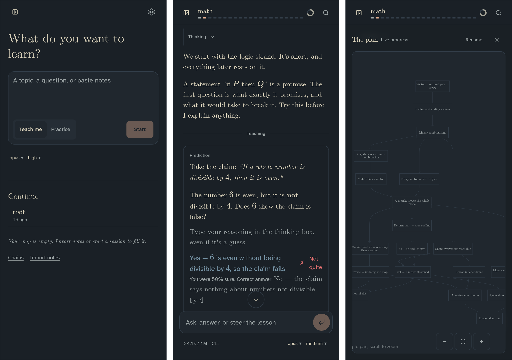

<p align="center">
  <picture>
    <source media="(prefers-color-scheme: dark)" srcset="docs/assets/lh_banner_dark.png">
    <source media="(prefers-color-scheme: light)" srcset="docs/assets/lh_banner_light.png">
    
  </picture>
</p>

<p align="center"><strong>An agent harness for learning.</strong></p>

This is an unofficial, independently maintained fork of [LearnHarness](https://github.com/amosblomqvist/learnharness). It is not supported by the upstream project. For fork-specific issues, use this repository's Issues tab.

LearnHarness uses AI agents to plan and teach lessons from your current understanding to your goal. It builds a detailed picture of what you understand and how you reason. That picture is updated as you learn.

Instead of just giving you an explanation, it uses your answers and thinking to decide what you need next. Teaching builds understanding one reasoning step at a time. Practice makes it usable. A persistent knowledge graph carries it across sessions.



Screenshots are from this fork running in a phone-width browser. Upstream's README shows its desktop app, which this fork does not ship.

## How it works

1. **Measure.** Before teaching, the agent finds where your understanding ends on each part the lesson depends on. Your answers, confidence, and thinking show it where to start.
2. **Plan.** It works out a dependency map from that starting point to your goal. You can see the plan, and the lesson adapts when your understanding turns out different.
3. **Teach.** Each step builds on something you already understand. You predict, get an explanation, and check your understanding. Confusions are repaired before anything is built on them. The aim is for the goal to feel obviously true, not merely familiar.
4. **Practice.** Separate sessions pose varied problems that require the right knowledge to come to mind without being named first. Problems and hints adapt to your reasoning.

**Think out loud.** The thinking fields let you explain your reasoning, uncertainties, and reactions in your own words. This is how the agent gets a detailed picture rather than just a record of right and wrong answers.

The agent can also research questions in the background, create visual explanations, and build interactive demonstrations.

## Knowledge that carries forward

What you are taught accumulates as propositions and reasoning chains: individual claims and the premises that lead to them. The stored graph links ideas back to their source sessions and supports future teaching, practice, and note imports. It is knowledge data, not a visual graph page or a rating of your ability.

## What differs from upstream

This fork is a self-hosted browser app. It keeps upstream's teaching, practice, and knowledge-graph engine and changes the shell around it.

### Removed from upstream

| Upstream feature | Status in this fork |
| --- | --- |
| Electron desktop app, installers, and in-app updater | Removed; no update banner |
| Next.js app and API routes | Removed |
| First-run setup dialog | Removed; configure through environment and `data/settings.json` |
| ChatGPT, Copilot, and Grok subscription sign-in | Removed |
| In-app API-key editing | Removed; provider credentials stay on the server |
| Dictation (speech-to-text) | Removed |
| Visual knowledge-graph page | Removed; the graph is still stored and used, with a chains view |
| Separate desktop plan window | Removed |
| Keyboard-shortcut settings and cheat sheet | Removed |
| Font picker and serif-title toggle | Removed |
| Desktop file-path drag-and-drop | Removed |

### Swapped in as replacements

| Upstream | This fork |
| --- | --- |
| Next.js pages | Vite + React SPA with `wouter` routing |
| Next.js API routes | Hono API and static server (`node dist/server.js`), serving brotli/gzip assets precompressed at build time |
| Desktop installers | Docker image (amd64) plus a [Compose template](compose.private.yml) |
| Desktop app access on the local machine | HTTPS web access gated by origin checks and Basic auth, or an optional Tailscale identity allowlist |
| Claude Code CLI found on the desktop machine, with an in-app status panel | Claude Code CLI (`claude -p`) pinned in the Dockerfile, authenticated with `CLAUDE_CODE_OAUTH_TOKEN` from `claude setup-token` |
| Settings-form custom endpoint | Server-managed OpenAI-compatible providers via `LH_CUSTOM_PROVIDERS` |
| Desktop layout | Phone-first layout at every width: overlay sidebar, plan sheet, transcript questions, Settings sheets, iOS haptics where supported, and a home-screen web-app manifest |
| Demo checks through the desktop's browser service or system Chrome | Version- and SHA-256-pinned Chrome for Testing headless shell inside the image |
| Data stays in the desktop app's folder | Optional `scripts/backup-*.sh` (restic over a forced-command SSH tar stream) and `scripts/export-learn.mjs` (sessions as Markdown) |

The upstream [custom-endpoint guide](docs/custom-providers.md) describes the settings-backed endpoint, not `LH_CUSTOM_PROVIDERS`. This fork incorporates selected changes from upstream 0.4.0 by applying diffs rather than merging upstream releases.

## Self-hosting with Docker Compose

The included [`compose.private.yml`](compose.private.yml) is a template for a single-owner deployment. Docker on an amd64 host, an HTTPS tailnet-only reverse proxy, and a Claude Code setup token (if using Claude) are prerequisites. From the repository root:

1. Create `data/`, `claude/`, and `secrets/`. Give the container's `node` user (UID 1000) write access to `data/` and `claude/`; keep `secrets/` owner-only and readable by that container user. Keep these paths and their contents out of Git.
2. Create `secrets/runtime.env` with your own values (placeholders below). The web token must be a fresh 64-character hexadecimal secret, for example from `openssl rand -hex 32`; do not use a provider key as the web token.

   ```dotenv
   LH_WEB_ORIGIN=https://your-host.example.ts.net
   LH_WEB_ACCESS_TOKEN=<64-hex-character-random-secret>
   CLAUDE_CODE_OAUTH_TOKEN=<token-from-claude-setup-token>
   # Optional: comma-separated Tailscale login names admitted without Basic auth.
   # LH_TAILSCALE_USERS=you@example.com
   # Optional: JSON array of server-managed OpenAI-compatible provider definitions.
   # LH_CUSTOM_PROVIDERS=[{"id":"example","baseUrl":"https://api.example.com/v1","apiKey":{"env":"EXAMPLE_API_KEY"},"models":[{"id":"model-id","contextWindow":8192,"maxTokens":4096}]}]
   # EXAMPLE_API_KEY=<provider-key>
   ```

   Omit the Claude token if not using Claude. `LH_CUSTOM_PROVIDERS` accepts provider/model definitions, including optional header values sourced from environment variables; see [`src/agent/custom-providers.ts`](src/agent/custom-providers.ts) for its schema. Do not put real credentials directly in that JSON.
3. Create `secrets/auth.json` containing `{}` for an empty server credential map; the Compose template mounts `secrets/` and sets `LH_AUTH_FILE=/secrets/auth.json`. Server credentials may alternatively be supplied through supported environment variables. No browser form edits provider credentials.
4. Start the stack: `docker compose -f compose.private.yml up -d --build`. Compose publishes host loopback port 3000 by default; set `LH_HOST_PORT` in the shell (or a Compose `.env` file) to choose another host port. Configure Tailscale Serve to terminate HTTPS at `LH_WEB_ORIGIN` and proxy to that host-loopback port; preserve the public `Host` header. Grant access through your tailnet policy, not Funnel. The server listens on port 3000 inside the container.
5. To use Claude, enable it in `data/settings.json` with `"claudeCode": {"enabled": true}` in the settings object and restart the service. Pick installed/configured models in the app's Settings. Keep the mounted `claude/` directory writable by UID 1000 for CLI state.

## Security

The server fails closed without `LH_WEB_ORIGIN` and `LH_WEB_ACCESS_TOKEN`. It checks the public Host and origin on requests; mutations require the matching `Origin`. An optional `LH_TAILSCALE_USERS` comma-separated allowlist admits matching `Tailscale-User-Login` identities from Tailscale Serve; otherwise use HTTP Basic username `learnharness` and the web token as password. The identity header is only trustworthy when the host port stays bound to loopback behind Serve. This is a single-owner gate, not multi-user authorization. Keep the service behind HTTPS, authentication, and restrictive tailnet policy; do not expose its container port or use Funnel.

Demo verification launches Chrome with `--no-sandbox` to run model-written HTML. Treat the host and the content as untrusted together: do not give the service access to host secrets beyond what it needs, and do not expose it to untrusted users. Keep provider credentials and conversation data private; model requests and optional web search contact external services.

## Development

```bash
npm ci
npm run dev        # Vite at localhost:5173; API at localhost:3000
npm run build      # build client and server
npm start          # serve dist/server.js (requires configured browser access)
npm test           # node:test via tsx
npm run lint       # ESLint
npm run typecheck  # TypeScript
```

For local development, set `LH_WEB_ORIGIN=http://localhost:5173` and a dedicated `LH_WEB_ACCESS_TOKEN` in `.env.local`; `npm run dev` loads that file. Vite is a development server, not the authenticated production static server.

## License

[AGPL-3.0-only](LICENSE), as in the upstream project. If you modify this software and let users interact with it over a network, the AGPL requires you to offer those users the corresponding source code of your modified version.
