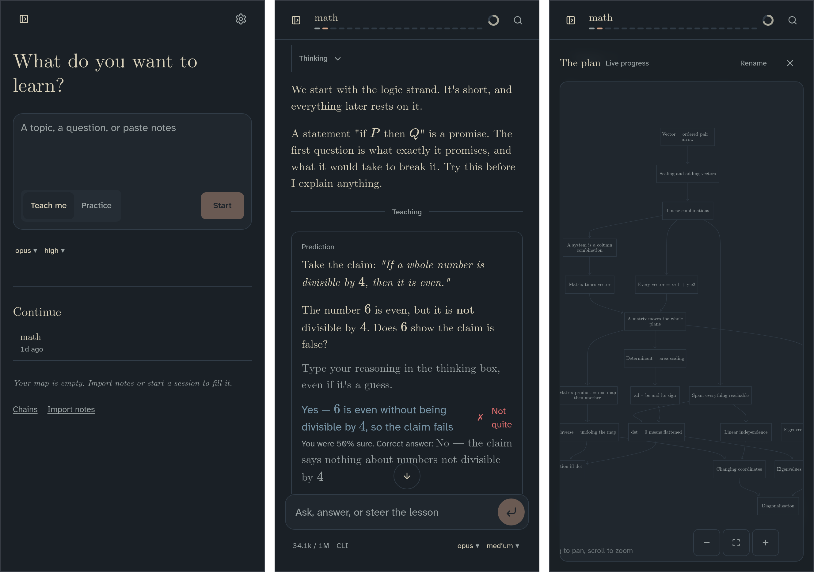
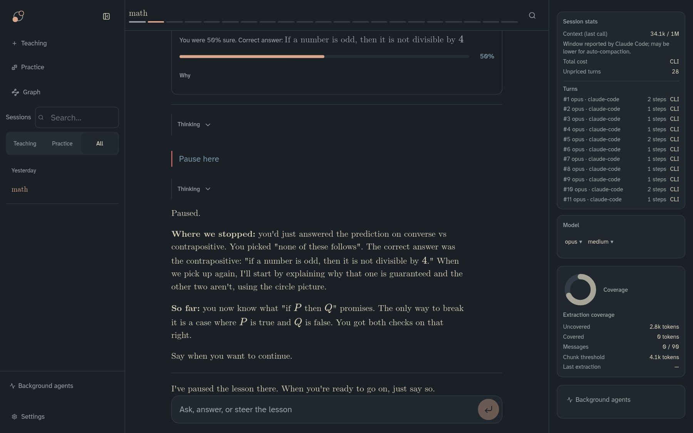
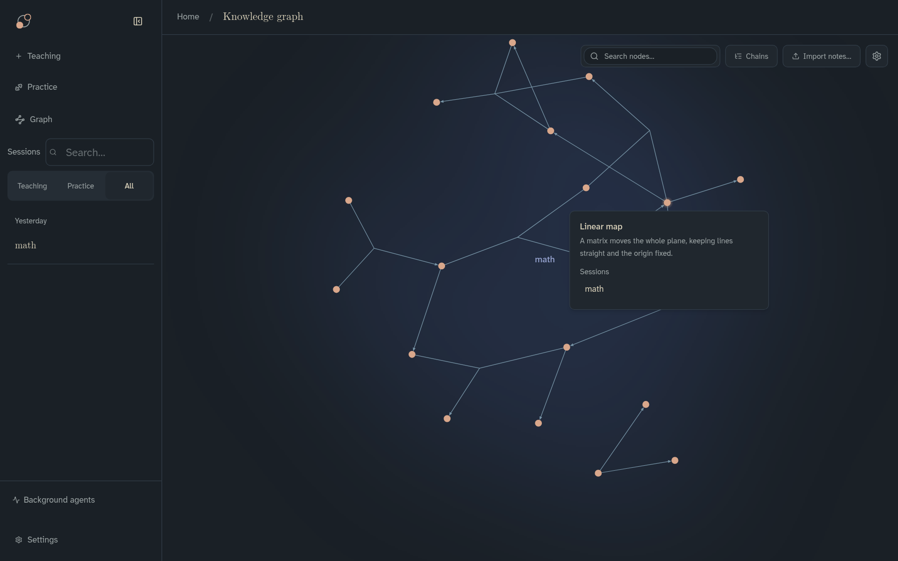

<p align="center">
  <picture>
    <source media="(prefers-color-scheme: dark)" srcset="docs/assets/lh_banner_dark.png">
    <source media="(prefers-color-scheme: light)" srcset="docs/assets/lh_banner_light.png">
    
  </picture>
</p>

<p align="center"><strong>An agent harness for learning — self-hosted, in the browser, on phone and desktop.</strong></p>

> [!NOTE]
> Unofficial, independently maintained fork of [LearnHarness](https://github.com/amosblomqvist/learnharness), not supported by upstream. Use this repository's Issues tab for fork-specific problems.

> If you think I read any of its code, you would be dreaming. Haven't opened nvim for a good while.

LearnHarness teaches from where your understanding ends to your goal: it measures, plans a dependency map, teaches one reasoning step at a time, and sets practice that makes you recall ideas unprompted. What you learn, and the notes you import, accumulate in a knowledge graph of claims and reasoning chains that later lessons and practice build on. Upstream's [README](https://github.com/amosblomqvist/learnharness#readme) explains the method in full; the engine here is the same.

This fork changes the shell around that engine: a browser app you host yourself, instead of a desktop app.







## What differs from upstream

| Area | Upstream | This fork |
| --- | --- | --- |
| Delivery | Electron desktop app with installers and updater | Browser app: Vite + React SPA served by a Hono server, shipped as a Docker image (amd64) |
| Access | Local desktop window | HTTPS behind origin checks and Basic auth, or a Tailscale identity allowlist |
| Layout | Desktop window | Phone: overlay sidebar, plan sheet, home-screen web app. Desktop (≥1100px): docked sidebar with icon rail, Explore panel, visual graph; ≥1280px adds a session rail with stats, model and coverage |
| Model slots | Settings → Agent | Also a **Helpers** dropdown beside the model picker for the cheap and vision slots; light/dark/auto switch beside Settings |
| Claude | Claude Code CLI found on the machine | CLI pinned in the image, signed in with `CLAUDE_CODE_OAUTH_TOKEN`; thinking text is requested so it is visible (`--thinking-display summarized`) |
| Credentials | Edited in the app | Server-side only: environment, `secrets/auth.json`, and OpenAI-compatible providers via `LH_CUSTOM_PROVIDERS` |
| Data safety | App folder | Atomic, fsynced writes; corrupt records are skipped in lists instead of blanking the app; optional restic backup scripts and Markdown session export (`scripts/`) |
| Demo checks | Desktop browser service | Version- and SHA-256-pinned headless Chrome inside the image |

**Removed:** first-run setup dialog, ChatGPT/Copilot/Grok subscription sign-in, in-app API-key editing, dictation, the separate plan window, keyboard-shortcut settings, font picker, desktop file drag-and-drop.

Upstream releases are ported selectively by applying diffs, not merged. The [custom-endpoint guide](docs/custom-providers.md) is upstream's and describes its settings-based endpoint, not `LH_CUSTOM_PROVIDERS`.

## Self-hosting

You need Docker on an x64 host, a tailnet-only HTTPS proxy (Tailscale Serve), and — for Claude — a token from `claude setup-token`. The image is [`banner7/learnharness`](https://hub.docker.com/r/banner7/learnharness) (`linux/amd64` only): `latest` follows `main`, and `sha-<commit>` pins a build.

1. Create `data/`, `claude/` and `secrets/` next to [`compose.private.yml`](compose.private.yml). `data/` and `claude/` must be writable by UID 1000; keep `secrets/` owner-only. Keep all three out of Git.
2. Write `secrets/runtime.env`:

   ```dotenv
   LH_WEB_ORIGIN=https://your-host.example.ts.net
   LH_WEB_ACCESS_TOKEN=<openssl rand -hex 32>
   CLAUDE_CODE_OAUTH_TOKEN=<token-from-claude-setup-token>   # omit if not using Claude
   # LH_TAILSCALE_USERS=you@example.com                      # admit these logins without Basic auth
   # LH_CUSTOM_PROVIDERS=[{"id":"example","baseUrl":"https://api.example.com/v1","apiKey":{"env":"EXAMPLE_API_KEY"},"models":[{"id":"model-id","contextWindow":8192,"maxTokens":4096}]}]
   ```

   The schema for `LH_CUSTOM_PROVIDERS` is in [`src/agent/custom-providers.ts`](src/agent/custom-providers.ts); reference keys by env name, never inline.
3. Write `secrets/auth.json` as `{}`.
4. Start it: `docker compose -f compose.private.yml up -d` (add `--build` to build from the checkout). It listens on host loopback port 3000 (`LH_HOST_PORT` changes it). Point Tailscale Serve at that port with the `Host` header preserved.
5. For Claude, add `"claudeCode": {"enabled": true}` to `data/settings.json`, restart, and pick models in Settings.

> [!TIP]
> To check the server from the host itself, send Basic auth (`learnharness` / the web token) plus `Host` and `Origin` matching `LH_WEB_ORIGIN` to `http://127.0.0.1:3000` — requests to `localhost` without them are refused by design.

> [!WARNING]
> Restarting the container aborts any running note import or extraction. Let background agents finish first.

## Security

The server refuses to start without `LH_WEB_ORIGIN` and `LH_WEB_ACCESS_TOKEN`, checks Host and Origin on every request, and requires a matching `Origin` for writes. It is a single-owner gate, not multi-user authorization: keep it behind HTTPS and a restrictive tailnet policy, never Funnel, and keep the host port on loopback so the Tailscale identity header can be trusted.

Demo checks run model-written HTML in Chrome with `--no-sandbox`. Give the container nothing beyond what it needs. Model requests and optional web search reach external services.

## Development

```bash
npm ci
npm run dev        # Vite on :5173, API on :3000 (reads .env.local)
npm run build
npm test
npm run lint
npm run typecheck
```

For local development put `LH_WEB_ORIGIN=http://127.0.0.1:5173` and a dedicated `LH_WEB_ACCESS_TOKEN` in `.env.local`. More in [docs/development.md](docs/development.md).

## License

[AGPL-3.0-only](LICENSE), as upstream. If you run a modified version for others over a network, you must offer them its source.
