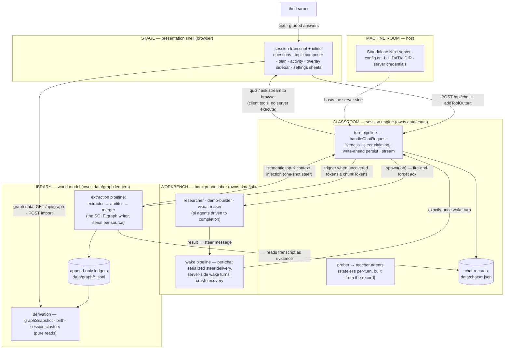

# Development guide

The developer README (split out of the storefront README, 2026-10-10). Everything below is for people working ON LearnHarness, not using it.

A browser-only learning app: a **teacher agent** (Vite + React SPA, Hono API/static server, LLM engine [pi-ai](pi-engine-swap.md)), probe→teach lessons with graded quiz/ask interactions, a formal **session plan tree**, and a persistent cross-session **knowledge graph** of propositions and reasoning chains. The phone UI is the only layout at every viewport width.

Sessions accumulate into the graph through the extraction pipeline; the stored propositions and reasoning chains remain available to teaching, import, practice and graph APIs. The teacher reaches back into the graph through read-only prober tools on its own judgment so probing compounds across sessions. There is no graph canvas or rendering toggle.

- [`architecture.md`](architecture.md) documents the core/server architecture and historical UI decisions; its UI passages are superseded by the phone-only cutover described here. (The pre-audit spec is under `docs/archive/` — history only.)
- Living design doc (with UI supersession note): [`vision.md`](vision.md)
- Historical build plan + wave/gate results: [`plan.md`](plan.md)

## Commands

```bash
npm install          # once

npm run dev          # Vite http://127.0.0.1:5173 + Hono API http://127.0.0.1:3000
npm run build        # dist/client (Vite) + dist/server.js and runtime assets
npm start            # Hono serves the production SPA and API on port 3000

npm test             # the full suite (node:test via tsx; deterministic, no LLM, no network)
npm run lint         # eslint — includes the import law (architecture §2)
npm run typecheck    # tsc --noEmit


# one-shot data scripts (run from the master tree only — data never crosses trees)
npx tsx --env-file=.env.local scripts/import-notes.ts <dir>   # bulk-import notes → graph
npx tsx --env-file=.env.local scripts/backfill-graph.ts       # wipe + re-extract every chat
```

Production runs as a Hono Node server in Docker. `npm run build` bundles application server code with esbuild while leaving packages external; the runtime image installs complete production dependencies so pdfjs workers/fonts, pi-ai data, Photon WASM and native canvas/resvg bindings retain their original paths. `dist/runtime/` holds only immutable prompt and image-worker assets, copied to the application root in the image. Repository data and credentials never enter the build payload. Desktop packaging and in-app updates are not part of this fork.

### Client development

`npm run dev` loads `.env.local`, starts the API with Node's watch mode, and starts Vite. Set `LH_WEB_ORIGIN=http://127.0.0.1:5173` for the browser dev origin; Vite proxies `/api` (including SSE) to port 3000 without rewriting the public Host. `PORT` changes the backend port. Use the production server for access-gated HTML/assets; Vite is a local development server, not a deployment endpoint. `npm start` uses the exported environment, so load the same settings explicitly when running it outside Docker. The server listens on `HOSTNAME` (default `0.0.0.0`) and `PORT` (default `3000`); start commands run from the application root so immutable runtime assets resolve.

## Environment (`.env.local`)

Secrets and machine-specific paths only. Model choice and thinking budgets are the user's, not the environment's — BYOK model slots live in **settings** (`models` section: strong/cheap/vision, provider + model id + optional thinking level; per-role and per-chat overrides ride on top). The extraction batch threshold is a settings knob too (`graph.extractionChunkTokens`, default 4096, floor 500).

| Variable | Purpose |
|---|---|
| Provider key such as `ANTHROPIC_API_KEY`, `OPENAI_API_KEY` or `OPENROUTER_API_KEY` | Server-configured credentials for selected model slots; OpenRouter is optional. See [`pi-engine-swap.md`](pi-engine-swap.md) for Claude and custom provider configuration. |
| `TAVILY_API_KEY` or `BRAVE_API_KEY` | optional — researcher's `web_search`; without either key search is unavailable. Tavily wins when both exist unless settings explicitly select an engine. |
| `CHROME_PATH` | optional explicit system Chrome executable for demo verification; otherwise known system installation paths are searched |

Credentials are configured out-of-band in server environment variables or owner-only credential files (`LH_AUTH_FILE` for plain API keys). The server reads these files; no API-key editing or provider sign-in UI exists. Settings → Providers shows read-only server connection status. Reading typography remains configurable; theme colors/mode and setup dialogs are not settings. PDFs render natively with pdfjs/Skia; SVGs use resvg.

### Private browser access

The browser server is **fail closed**: no page, static asset or API is available until both variables below are configured. This includes SSE, downloads, model spending, settings and all HTTP methods. There is no desktop authentication bypass.

| Variable | Purpose |
|---|---|
| `LH_WEB_ACCESS_TOKEN` | A dedicated random 64-character hexadecimal secret. Generate one with `openssl rand -hex 32`, keep it in an owner-only environment file, and never use a provider/API credential. |
| `LH_WEB_ORIGIN` | The exact public HTTPS origin, including a nondefault port if any, for example `https://your-host.example.ts.net`. No path, query or credentials. Local development also accepts an HTTP loopback origin such as `http://localhost:3000`. |
| `LH_TAILSCALE_USERS` | Optional comma-separated Tailscale login names (for example `you@example.com`) admitted without the password when the request carries a matching `Tailscale-User-Login` header from Tailscale Serve. Leave unset to require Basic auth for everyone. |

With `LH_TAILSCALE_USERS` set, an allowlisted tailnet user opens the origin with no prompt; this also lets installed browser apps work when they do not reuse the browser's Basic-auth cache. Tailscale Serve deletes client-supplied `Tailscale-User-*` headers and fills them only for untagged tailnet users, so the header is trustworthy only while the server listens on loopback behind Serve: any local process on the Serve host can forge it. Everyone else still uses **`learnharness`** as the HTTP Basic username and the access token as the password. The browser's native authentication cache supplies credentials to same-origin fetches, EventSource and downloads; the app does not put the token into JavaScript, localStorage, cookies or URL parameters. Missing/invalid server configuration returns 503; missing/incorrect credentials return 401. Host and Origin checks apply to both paths.

For a Tailscale Serve deployment:

- For a native Node deployment, bind to **127.0.0.1** (`HOSTNAME=127.0.0.1 npm start`). In Docker, the process listens on 0.0.0.0 **inside the container** and Compose publishes only a host-loopback port. Terminate HTTPS at tailnet-only Tailscale Serve and proxy only to that host-loopback port. Do not enable Funnel or an unauthenticated alternate listener.
- Preserve the public `Host` header exactly as configured in `LH_WEB_ORIGIN`, and pass `Authorization`, `Origin` and `Sec-Fetch-Site` through unchanged. The app never trusts `X-Forwarded-*`; it trusts `Tailscale-User-Login` only for logins listed in `LH_TAILSCALE_USERS`. A rewritten/mismatched host returns 403 rather than silently weakening the gate.
- Keep tailnet ACLs restrictive as a second boundary. HTTP Basic is not encrypted by itself; HTTPS is mandatory off loopback.
- Requests with an `Origin` must match `LH_WEB_ORIGIN`. Cross-site/same-site-but-not-same-origin browser requests are refused, and every non-GET/HEAD/OPTIONS request also requires the matching `Origin`. Command-line API clients must send both Basic credentials and that `Origin` for mutations. These rules protect ambient Basic credentials against CSRF and reject cross-origin preflights.
- API and refusal responses are private/no-store and cannot be framed. Authenticated content-hashed client assets are private/immutable; HTML and other static files revalidate with private/no-cache. The access token is stripped from the artifact-browser helper environment.

This is a single trusted-owner gate, **not** multi-user accounts, read-only sharing, per-device access, a provider credential vault or protection from code running as the same OS user. An authenticated client can read/change application data and spend provider credits, but cannot edit credentials through the API. Use a high-entropy token: there is no login rate limiter or account lockout. Basic authentication has no reliable in-app logout; clear the browser's site/authentication state and rotate the token plus restart the server to revoke clients and active streams. Never put the token into URLs, logs or screenshots.

The responsive UI applies at every browser width. The header toggle opens the sidebar as an overlay drawer rather than reducing conversation width; its backdrop, close button, or navigation dismisses it. Settings opens in sheets; questions and their answers live in the transcript, not a separate dock. There are no app shortcuts or keybinding settings.

The installed app uses `viewport-fit=cover`. The drawer header and footer, page top bars, and composers respect device safe areas; Settings and active background-agent controls span their rows with touch-sized targets.

In the session list, touch/pen swipe left on a row reveals Delete; tap it to open the existing two-mode confirmation dialog. Swipe right, tap the open row, or scroll to dismiss the action. Hold a row still for about half a second to open the context menu (Rename, Export as Markdown, Delete, and Extract); dragging to scroll or swipe cancels the hold.

## Architecture

Five layers, dependency arrows pointing inward only, machine-enforced as four ESLint zones (shell → barrels only; core and agent never import below themselves). Two composition roots, one writer per store. The full spec — layers, systems, runtime flows, invariants, seams: [`docs/architecture.md`](docs/architecture.md).



**Core invariant:** the extraction pipeline (extractor → auditor → merger) is the sole graph writer — tree-blind and post-hoc, triggered by token coverage, not quiz counts. The LLM stages propose, verify, and judge identity (link-or-create against the current graph; each finding carries verbatim evidence and message-granular provenance); the deterministic merger owns every ledger append (ids, provenance, chain dedupe — the same argument re-asserted merges under one `arg_` id). Every node is an objective, world-facing fact; the learner's relationship to it lives entirely in practice records — feedback-only, never written back. The teacher stays a teacher; everything below the ledgers is derived.

## Layout

```
web/                            Vite React SPA — entry, providers and client routes
server/                         Hono app + Node entrypoint; routes/ holds API handlers
components/                     phone UI at every width: session transcript and inline questions,
                                topic composer, plan, artifact renderers (registry: artifacts/),
                                activity, overlay sidebar and settings sheets
src/
  agent/
    system-prompt.md            base teaching behavior (the methodology)
    prompts/{prober,teacher}/   composed numbered fragments per role
    teacher-agent.ts            prober/teacher factories (engine injectable for tests)
    tools.ts                    tool composition; quiz / ask_user_question (client tools)
    tools/plan.ts               plan_init (author-once mermaid plan, deterministic parser)
    tools/probe.ts              probe_done (probe→teach handoff seam)
    tools/jobs.ts               research / demo / visual tool surfaces
    tools/web.ts                web_search (Google CSE) + web_fetch (researcher only)
    subagents/                  researcher · demo-builder · visual-maker
                                · pdf-reader,
                                extraction pipeline (extractor/auditor + merger handoff),
                                runner (async protocol), native renderers + browser-service helper,
                                abort registry
  server/chat-handler.ts       THE turn composition root (liveness · steers · persist · stream)
  server/turn-service.ts       turn seams: persist · extraction trigger
  server/jobs.ts               the wake pipeline: serialized per-chat steer delivery,
                               server-side wake turns, crash recovery
  server/stores.ts              THE storage composition root — the one place adapters wire in
  server/turn-liveness.ts       per-chat turn registry (one turn per chat, ever)
  server/observability.ts       the activity feed (running jobs + extraction, abort)
  server/pi/                    the engine bridge: record-adapter (record → pi messages)
                                · ui-stream (pi events → UIMessage SSE)
  server/index.ts               the server barrel (the only server import server/ may use)
  core/contracts/{plan,graph,chat,jobs,probe,models}.ts
                                the contracts — one file per domain
  core/ports.ts                 storage ports — ChatStore · GraphStore · JobStore
                                (core code depends on these types only)
  core/                         question-core, plan-tree, phases, pending, graph
                                (merger/derivation), coverage, layout, clusters,
                                prices, tool-parts — all pure: storage
                                arrives as parameters
  store/                        fs adapters implementing the ports: chats · graph
                                ledgers · jobs (+ default-settings)
scripts/                        build.mjs (externalized server + immutable runtime assets),
                                dev.mjs, import-notes, backfill-graph
data/                           chats/ · graph/ (nodes/chains/sessions/coverage
                                ledgers + sources maps) ·
                                jobs/ · settings.json — runtime state, git-ignored
```

## Key mechanisms

See [compaction and accounting](compaction-accounting.md) for the local Pi cutoff port,
measurement-only context meter, and server-side current-catalog pricing. There is no
pricing-generation step: Pi AI's catalog and public calculator are the authority.

**Client-side question tools.** `quiz` and `ask_user_question` have no server `execute`: the tool call streams to the browser, the learner answers inline in the transcript, the client grades via `question-core` and returns the verdict with `addToolOutput` — which fires the SDK continuation so the teacher resumes mid-turn. Options are shuffled deterministically (seeded by toolCallId) so server and client renders match. A pending quiz persisted in the chat record is exactly what makes **resume mid-question free**.

**The formal plan tree (author-once).** The teacher authors the session's dependency tree with one schema-validated tool — `plan_init`, whose mermaid-subset input is parsed deterministically (line-numbered errors) and validated as a DAG. The tree persists in the chat record; progress is never mutated — `current`/`visited`/upcoming are **derived** from tagged quiz calls in the transcript, and the panel renders that derivation.

**The async sub-agent protocol (ack-and-steer).** `research` / `demo` / `visual` are server-executed tools: the call resolves immediately mid-turn with a fire-and-forget ack and the teacher keeps teaching; a background runner works in parallel (the client polls `/api/activity` and `/api/jobs`). On completion the runner builds a **steer message** — a user-role `UIMessage` whose text part is the model-facing result and whose `data-subagent-artifact` part carries the full result for the client — and the **wake pipeline** delivers it: a per-chat serialized queue waits for the turn to end and no question to be pending, then fires a server-side teacher turn that weaves the result into the lesson. Delivery is exactly-once (deterministic steer ids, delivered-flag checks at every claim point); stalled jobs are recovered on read; aborted jobs deliver an abort steer. The client adopts the wake turn through the same `turnInFlight` machinery as returning mid-stream (busy shimmer, composer gate) and renders steers as artifacts — never a bubble. Sub-agents **verify, never one-shot**: the demo-builder executes its HTML in the app's own Chromium browser-service (system Chrome fallback) before delivery; the visual-maker rasterizes each SVG natively and looks at it (vision-capable model — the `vision` slot in settings).

**The knowledge graph (two channels, one writer).** The write channel is the extraction pipeline: extractor assembles propositions and reasoning chains from a session or imported notes, auditor judges node identity against the existing graph, and the deterministic merger writes ledgers and checkpoints coverage. Each source's batches run strictly in order. No quiz outcomes or understanding assessments live in the graph; practice consumes it as feedback-only problem sets and writes nothing back. Chat extraction is triggered when uncovered tokens cross `graph.extractionChunkTokens`; failures checkpoint nothing. `POST /api/graph/import` sends Markdown or text sources through the same pipeline and deduplicates by path hash. The read channel derives propositions, chains, provenance and birth-session clusters from stored ledgers for graph APIs, teacher tools and practice. There is no home graph renderer, camera, drag-committed layout, or render-settings control; disabling extraction is independent of displaying the home topic composer. The gated prober tools (`list_sessions` / `list_propositions`, `agent.graphTools`) let the teacher consult graph data without automatic context injection.

**Practice (problem sets).** A node selection resolves to the STORED reasoning chains it fully contains (a chain rides iff every member is selected; unchained nodes ride as singletons); the `/practice` creation flow picks a birth-session cluster and freezes its propositions + chains into a self-contained `ProblemSet`. Practice node pages retain access to graph-backed selections without a visual graph page or chain-table overlay. Three named-level axes steer generation (ladder rung 0–4, cue distance 0–2, Theory|Application — never a number to interpolate; defaults Direct exercise · Adjacent context · Theory), plus an optional free-form note the agents weigh but need not follow. A partitioner agent covers every chain exactly once, one generator per partition writes problems against the owner's problem-engineering framework (commit-before-pose: statement + solution + rubric together), and grading is **strengthening, not assessment** — one attempt per problem with its own submit button, instant solution/rubric reveal, then a score 0–10 with brief reasoning landing live; nothing ever written back to the graph. Runs are registry-backed background jobs on the activity surface (no steer, never wakes the teacher); sets live in `data/practice`, crash-swept on boot.


## Testing

All deterministic, no LLM, no network (engines are injected — pi-ai's faux provider scripted per test; `globalThis.fetch` stubbed where transport matters):

1. **Pure core units** — merger (via the real fs adapters, backup-and-restored), derivation, coverage, question grading, plan tree, phases, clusters, layout, tool-parts, prices.
2. **Server flows** — `handleChatRequest` driven end-to-end with scripted engines: persistence, liveness, steer claiming, the wake pipeline (409 retry, quiz deferral, idempotency), crash recovery, the data-dir seam (including a fresh child process).
3. **Sub-agent loops** — researcher/demo-builder/visual-maker with fake headless APIs; the extraction pipeline end-to-end (audit drops, failure-checkpoints-nothing, single-flight, abort).
4. **Render tests** — transcript, cards, docks, composer, sidebar, coverage via React server-side rendering.
5. **Golden fixtures** (`tests/fixtures/golden-data/`) — a REAL data dir (real records produced by the app, never hand-edited), copied to a temp dir and read through the production paths via the `LH_DATA_DIR` seam. Pins that real data parses, flattens to a legal LLM wire, derives the graph end-to-end, covers every custom-marker kind, and that reads never write. **The fixture law:** an intentional on-disk format change updates the fixtures in the same commit — see the fixture README.

## Lineage

The teaching methodology comes from an Obsidian-based POC (its `knowledge graph design.md` was the original epistemic-model source, since amended — see the amendments table in `docs/vision.md`). The harness was originally built on the pi agent SDK, pivoted to standalone Next.js + the Vercel AI SDK, and later swapped its LLM engine back to pi-ai while keeping the AI SDK's `UIMessage` as the client protocol ([`docs/pi-engine-swap.md`](docs/pi-engine-swap.md)).

## Data

Nothing under `data/` is ever tracked by git. Chats, graph ledgers, jobs, and settings records are plain files (JSON/JSONL) — inspect them freely; they are the canonical records. `LH_DATA_DIR` configures the server's data location.

**Schema stamps (2026-10-10):** chat records carry `version` (stamped at the store's write choke point; absence reads as v1 — lazy migration, no mass rewrite), and the graph family (ledgers and sources) shares one sidecar `graph/format.json`, created on the family's first write. A record stamped NEWER than the running build is refused on read — honest refusal for the downgrade scenario: a read-modify-write store never rewrites what it doesn't understand. The retired graph renderer's positions and render-settings files are not part of the current data contract.